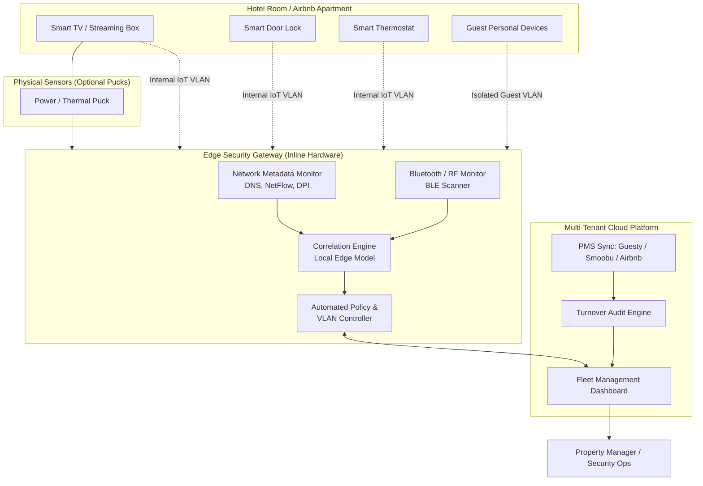

# IoT Security Kit Against Sleeper AI Agents
## Project Overview & Commercial Strategy (Hospitality & Short-Term Rentals)

**Date:** November 2026

**Context:** Proposal for a local edge cybersecurity defense system tailored for **boutique hotels, short-term rental (STR / Airbnb / VRBO) property managers, and managed residential apartments** against the exploitation of edge AI (small quantized LLMs) and rogue IoT implants. Designed as a Master's Thesis (TFM) for the Master in Project Management (EAE Madrid – PMBOK methodology).

---

## 1. Problem Statement & Threat Model

Smart home appliances and edge devices in hospitality properties (smart TVs, digital locks, connected thermostats, voice assistants, set-top boxes) have growing compute and memory capacity. Quantized small language models (SLMs: 0.5B–3B parameters) and autonomous edge payloads can:

- Be downloaded and executed locally on rich-OS edge hardware (Android TV, Tizen, WebOS, embedded Linux).
- Remain **dormant ("sleeper agents")** without outbound traffic, triggering only under specific conditions (e.g., date, presence of VIP guests, specific spoken keywords, or local network requests).
- Receive out-of-band commands via secondary local channels (Bluetooth/BLE, rogue firmware sideloading, or ad-hoc wireless links).
- Autonomously harvest credentials, spy via onboard microphones/cameras, conduct lateral network reconnaissance, or persist across guest stays.

### Limitations of Current Defenses in Hospitality:
- **Zero Endpoint Visibility:** Smart TVs, smart locks, and domestic appliances lack antivirus and endpoint detection and response (EDR).
- **The Blind Router:** Standard ISP modems and commercial mesh routers only monitor outbound internet packets; they cannot detect local compute spikes, peer-to-peer lateral scanning, or out-of-band RF communications.
- **The "Inter-Guest Cross-Contamination" Blind Spot:** If a guest compromises a smart TV or smart lock, that backdoor remains active for the next guest, exposing the property manager to severe legal liability and brand damage.
- **No Physical/RF Telemetry:** No routine monitoring of power draw anomalies (e.g., crypto-mining, sustained model inference) or unauthorized wireless transmitters.

---

## 2. Proposed Solution: Local Hospitality Security Kit

A dedicated **edge cybersecurity appliance and cloud fleet management platform**:

1. **Main Edge Gateway:** A compact, plug-and-play appliance (Raspberry Pi 5 / industrial Rockchip equivalent) placed inline between the ISP fiber modem and the local Wi-Fi router/AP.
2. **Multi-Channel Monitoring Engine:** Simultaneous continuous inspection across IP network metadata (DNS, NetFlow, bandwidth curves), Bluetooth/BLE advertising beacons, and local RF environments.
3. **Optional Physical Sensor Pucks:** Auxiliary non-invasive sensors placed near high-value appliances (smart TVs, main power outlets) to monitor baseline electrical draw and surface thermals.
4. **Local Correlation & Heuristic Engine:** An on-device anomaly engine that correlates cross-layer signals (e.g., unexpected 4GB blob download + sustained CPU heat + localized BLE beacon) to identify sleeper agent deployment.
5. **Multi-Tenant Fleet Management Dashboard:** A centralized cloud console for property managers overseeing 5 to 500+ properties with real-time status and PMS calendar integration.
6. **Graduated Containment Policies:** Automated guest VLAN isolation, smart home infrastructure micro-segmentation, and human-authorized device quarantine.

---

## 3. System Architecture

### Detection Layers

| Layer | What It Detects | Hospitality Benefit |
|-------|-----------------|---------------------|
| **Network Metadata (LAN/WLAN)** | Bulk model weight downloads (4GB+ blobs), abnormal internal port scanning, suspicious DNS queries, C2 beaconing | Detects payload downloads without inspecting guest personal data/traffic contents |
| **Bluetooth / RF (BLE + Classic)** | Rogue proximity beacons, covert wireless transmitters, unauthorized pairing attempts near smart locks | Identifies rogue hardware implants left behind in the room |
| **Side-Channels (Sensor Pucks)** | Thermal and electrical power draw deviations consistent with continuous matrix multiplication / inference | Flags silent compute or unauthorized hardware (e.g., crypto miners) |
| **Local Anomaly Correlation** | Fuses network, RF, and physical signals to suppress false positives | Minimizes false alerts so hosts aren't interrupted unnecessarily |

---

## 4. Hospitality-Specific Feature Set

### 1. "Turnover Sanitization" (Check-Out Audit Engine)
- **Problem:** Property managers need to verify that an apartment is clean and safe between guests.
- **Workflow:** The gateway synchronizes via API with Property Management Systems (PMS) such as Guesty, Smoobu, Beds24, or standard iCal feeds. During the turnover cleaning window (e.g., 11:00 AM check-out to 3:00 PM check-in), the system automatically executes a comprehensive diagnostic sweep:
  - Audits connected IoT devices for firmware integrity or unauthorized configuration shifts.
  - Clears guest pairing caches and checks for rogue persistent Bluetooth beacons.
  - Generates a **Turnover Health Score** for the property manager before the next guest arrives.

### 2. Automated Dynamic Micro-Segmentation
- Transient guest smartphones and laptops are automatically segregated onto an isolated **Guest VLAN**.
- Mission-critical smart home amenities (smart locks, access control keypads, thermostats, and internal sensors) reside on a locked-down, hidden **Management VLAN**.
- Prevents malicious guests from performing lateral network scanning or ARP poisoning against the property's access control infrastructure.

### 3. Rogue Hardware Implant Detection
- Identifies foreign hardware plugged into electrical sockets or Ethernet wall jacks (e.g., hidden wireless spy equipment, packet sniffers, or unauthorized high-draw crypto miners).

### 4. "Verified Cyber-Clean Stay" Trust Certification
- Automatically generates a digitally signed PDF certificate and digital badge confirming the room underwent automated digital sanitization before check-in.
- Serves as a premium marketing differentiator for high-end corporate business travelers and executive guests.

---

## 5. Comparative Advantage: Why Standard Modems/Routers Fall Short

| Capability | Standard ISP Modem / Consumer Mesh | Dedicated Hospitality Security Kit |
|------------|------------------------------------|------------------------------------|
| Guest vs. IoT Micro-Segmentation | Manual & easily misconfigured | Automated & enforced by default |
| Silent Local Compute Detection | Unsupported | Supported (side-channel power profiling) |
| Bluetooth / RF Implant Scanning | Completely blind | Dedicated multi-band radio sniffer |
| Turnover / PMS Integration | None | Native API sync (Guesty, Airbnb, iCal) |
| Fleet Management (50+ Properties) | None (individual router apps) | Multi-tenant single-pane-of-glass dashboard |
| Guest Privacy Compliance (GDPR/LOPD) | Uncontrolled | Privacy by Design (metadata-only monitoring) |

---

## 6. Privacy & Data Governance (The Hospitality Mandate)

Following the **Airbnb 2024 global ban on all indoor cameras**, privacy is the primary regulatory and customer-trust challenge in short-term rentals:

- **Metadata-Only Inspection:** The gateway inspects network metadata (flow volumes, packet headers, port destinations, DNS lookups) and **never inspects or reconstructs the contents (payloads) of guest personal traffic**.
- **GDPR & LOPD Compliance:** Adheres to European privacy regulations (GDPR Art. 25: Privacy by Design and Default). No audio, video, or personal browsing history is recorded or stored.
- **Local Edge Processing:** Primary threat correlation occurs locally on the gateway; only high-level security status alerts (Green/Amber/Red) are transmitted to the property manager's cloud dashboard.
- **Tenant Isolation:** Network logs are purged upon guest checkout, ensuring no cross-stay data retention.

---

## 7. Go-To-Market (GTM) Strategy & Commercial Model

### Target Market Segments
1. **Short-Term Rental (STR) Property Managers & Superhosts:** Professional operators managing 5 to 100+ apartments in urban hubs (Madrid, Barcelona, London, Paris).
2. **Boutique & Independent Hotels:** Properties (10–60 rooms) lacking dedicated in-house IT and cybersecurity departments.
3. **Corporate Housing & Serviced Apartments:** High-end units catering to corporate executives handling sensitive commercial data.

### Market Validation & Willingness to Pay
- Property managers already routinely budget for hardware-enabled PropTech solutions to protect physical assets:
  - Noise & occupancy monitors (**Minut, NoiseAware**): €10–€15/month per door.
  - Smart lock systems (**RemoteLock, Nuki, Yale**): €5–€10/month per door.
- **Value Proposition:** Cyber-physical asset protection, prevention of cross-guest liability, and a premium "Cyber-Secure Listing" badge that commands higher Average Daily Rates (ADR).

### Business Model & Unit Economics
- **Hardware Appliance (Capex):** €99–€149 upfront per gateway unit (or €0 upfront on an annual commitment).
- **SaaS Subscription (OpEx):** €14–€19/month per property/room:
  - Real-time fleet monitoring and multi-property dashboard.
  - Automated turnover sanitization audits & PMS calendar integrations.
  - Continuous threat intelligence, heuristic signature updates, and SMS/push emergency alerts.
- **Financial Projections (B2B SaaS Metrics):**
  - Gross Margin on SaaS: >80%.
  - High retention: Integrated into daily turnover operations, resulting in low annual churn (<5%).
  - Customer Acquisition Strategy: Direct B2B sales to regional property management associations (e.g., FEVITUR in Spain), partnerships with PMS platforms, and insurance/liability underwriting partnerships.

---

## 8. Academic Applicability: Master's Thesis (EAE Madrid – PMBOK)

Scoping this project to the hospitality industry dramatically enriches its application across PMBOK Knowledge Areas and Performance Domains:

- **Stakeholder Management:** Matrix covering property managers (buyers), transient guests (privacy-sensitive users), cleaning staff (operational turnover workflow), OTAs (Airbnb/VRBO compliance), and European data regulators.
- **Scope Management & WBS:**
  - *Phase 1 (MVP Deliverable):* Plug-and-play Gateway + Inline network/BLE engine + PMS turnover integration + Fleet Dashboard.
  - *Phase 2 (Expanded Scope):* Physical sensor pucks for power/thermal side-channel monitoring.
- **Schedule & Cost Management:** Phased rollout (Hardware prototyping, firmware development, cloud backend, 20-unit pilot across Madrid STRs). Bottom-up BOM costing, cash flow forecasts, and break-even analysis.
- **Quality Management:** Measurable KPIs including false alarm rate (<0.5%), audit execution time (<5 minutes during checkout window), and zero packet degradation on guest bandwidth.
- **Risk Management:**
  - *Operational Risk:* Accidental network disruption to guest streaming/work (mitigated by Human-in-the-Loop policies).
  - *Regulatory Risk:* Privacy violations under GDPR/LOPD (mitigated by strict metadata-only design).
  - *Supply Chain Risk:* Component lead times for gateway hardware (mitigated by utilizing commercial off-the-shelf single-board computers).
- **Procurement Management:** Evaluation of OEM contract manufacturing vs. standard white-label hardware assembly, cloud infrastructure hosting (AWS/GCP EU regions), and external penetration testing audits.

---

## 9. Recommended Next Steps & Roadmap

1. **Formalize Product Charter & Scope Baseline:** Define the Phase 1 MVP boundaries (Gateway + Cloud Fleet Console) and establish the WBS dictionary.
2. **Draft Technical Architecture & Pilot Specification:** Define the Linux-based gateway OS distribution, Suricata/Zeek network inspection rules, and BLE scanning daemon.
3. **Design Turnover Workflow Mockups:** Wireframe the Property Manager dashboard view and the PMS calendar webhook integration.
4. **Develop Financial Model (Business Case):** Model 3-year cash flows, CAC/LTV projections, and pricing sensitivity across 10, 50, and 200-property portfolio managers.
5. **Compile PMBOK Documentation Deliverables:** Construct the Project Management Plan, Risk Register, Communication Matrix, and Responsibility Assignment Matrix (RACI).
6. **Regulatory Compliance Review:** Validate alignment with the EU Cyber Resilience Act (CRA) and Spanish LOPDGDD regulations.

---

*Document compiled as an executive project overview and Go-To-Market blueprint for the IoT Security Kit Against Sleeper AI Agents (Hospitality & STR Edition).*